# chinese-shadow-speech — a Mandarin shadowing studio

**chinese-shadow-speech** turns any Chinese YouTube video or audio file into a shadowing lesson. It cuts the speech into short
sentences, aligns every character to the audio, adds pinyin, and gives you two ways to practise
speaking along: Echo (one sentence at a time) and Flow (a run of sentences, after or along with the speaker). Everything you record is kept. The sentences you have practised go to Anki as listening cards.

It runs on your own computer, and your recordings never leave it: a Python backend with the speech models and a
React app in the browser. On Windows it installs like a normal program ([Install on Windows](#install-on-windows));
for development it runs in WSL2/Linux, on a GPU or the CPU.

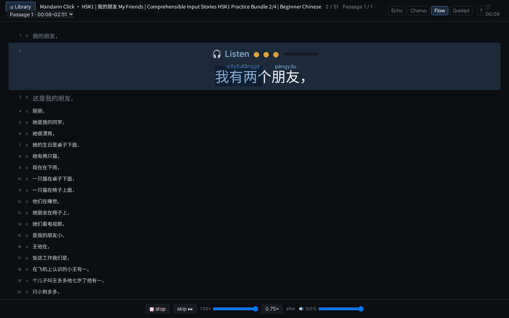

> Screenshots show lessons made from Mandarin Click's HSK1 stories.

---

## Contents

- [What it does](#what-it-does)
- [How a lesson is made](#how-a-lesson-is-made)
- [Keyboard shortcuts](#keyboard-shortcuts)
- [Install on Windows](#install-on-windows)
- [Getting started](#getting-started)
- [Development](#development)
- [Roadmap](#roadmap)

---

## What it does

### Lessons from YouTube or your own files

Paste a YouTube link into the Library, or click the **→ chinese-shadow-speech** bookmarklet on a YouTube page. You can also
drop an audio or video file, with or without a subtitle file. A few minutes later the lesson is ready:

- The whole video becomes one lesson, split into sentences and clauses at its punctuation.
- Long videos are split into **passages** of about 2–3 minutes. YouTube chapters are used when the video has them.
- Lessons are grouped by speaker (the YouTube channel). Each tile shows how many sentences and passages you have practised.

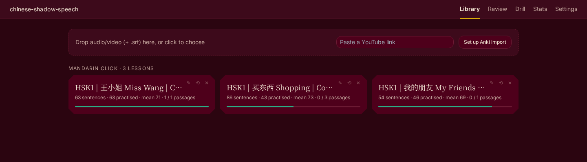

When a YouTube video has real Chinese subtitles, their text is used, with the timing taken from the speech
recogniser. Machine-translated auto-captions are refused, and so are subtitles that don't match the audio. A plain
`.txt` transcript works too.

### Two practice modes

| Mode | What you do |
|---|---|
| **Echo** | One sentence at a time: listen, then repeat it on your own. You hear the original and your take back to back. |
| **Flow** | Shadow a whole passage without stopping. *After*: each sentence plays, then you repeat it in the pause. *Along*: speak at the same time as the audio (use headphones). |

Chorus and Guided were removed on 2026-10-22; old Chorus and Guided takes still show.

The stage shows the sentence with pinyin (and a translation, for lessons imported from Anki notes that have one). Below it, a **two-track feedback block** shows the
reference and your take as waveforms trimmed to the voice, on one shared time scale. Click a character on the sentence
card to hear that syllable of the reference.

After a take, one row of verdict cells (yours) shows how each tone went, and clicking a cell plays your syllable: **green** is ok, **orange** is close, **red** is wrong and
shows the target and the tone heard (for example `3→2`), **grey ∅** is unvoiced, and a **dashed outline** is a syllable
that was missing. Pitch lines are drawn over both tracks: your curve with the speaker's warped faintly behind it, and
the reference curve on the reference track. A score appears in the header. Takes that are silent, too quiet, clipped
or too garbled to match the sentence are saved but not scored, and say why. A speech recogniser checks the words: a
take of a different sentence is not scored ("Heard different words — not scored. Heard: …"); a take where only some
words sounded different is scored as usual and the hint line says "Some words sounded different — heard: …". A
neighbouring sentence that shares most of its words with the one shown can still pass and be tone-scored.

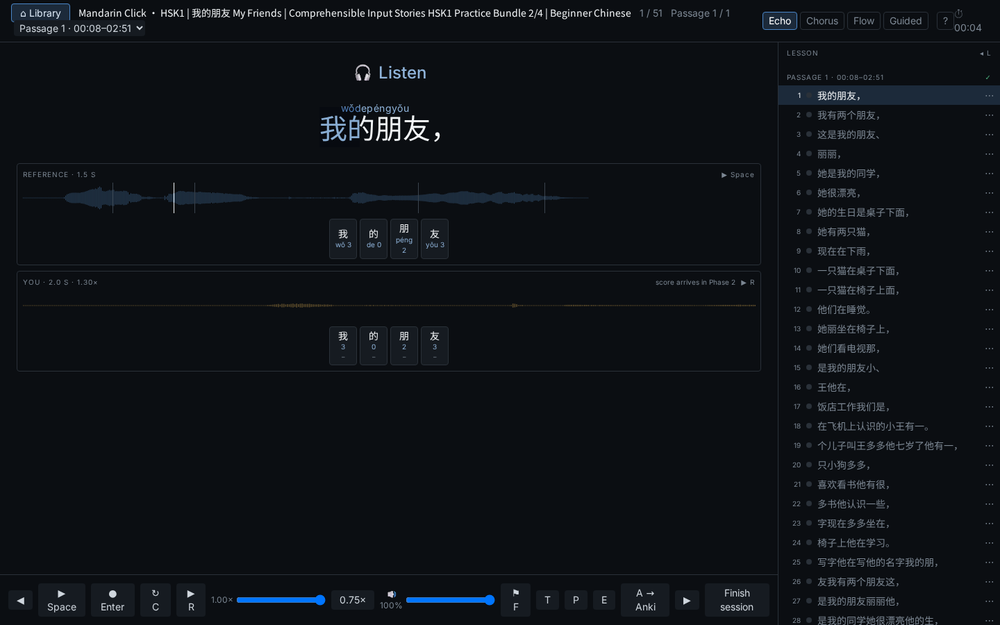

### It always tells you what to do

- **Stage state:** the stage always shows what to do now:
  - **Listening** (a small label while the speaker plays; **Listen — the original, then you** while your take is played back).
  - **Get ready** with a 3·2·1 ring (Flow only; in *along* the ring shows inside the Speak-along frame).
  - **Your turn** (or **Speak along**): a red frame, a pulsing red dot, the take's timer and a live waveform of your voice.
  - When nothing is going on, the button for the next step pulses gently: **Record** before a take (or a Flow run),
    **›** once the sentence has a take. With reduced motion switched on in your system, nothing moves.
- **Karaoke cues:**
  - The sentence fills with colour in time with the speaker.
  - During your turn, a fainter amber wipe runs at the speaker's pace.
- **Flow extras:** the Flow screen shows as soon as you choose Flow: a compact stage with a few lines before and after
  it, centred, moving on with the run; a preview of the next line and a bar that shrinks over your speaking window.

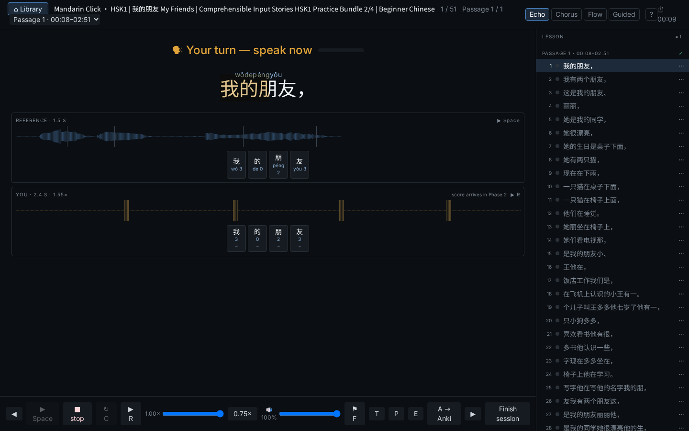

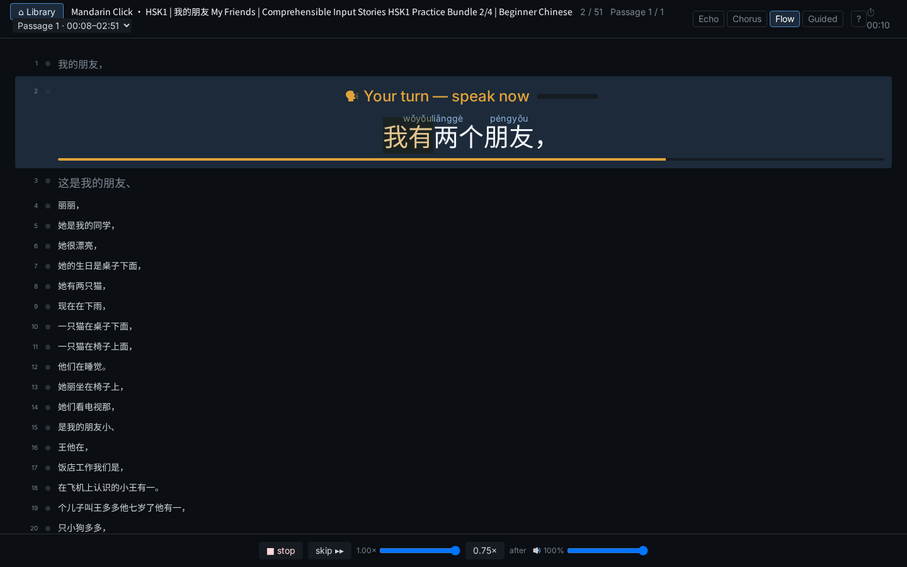

Hover over a mode tab for a one-line explanation, or press `?` for the full help. The help also opens by itself on your first visit.

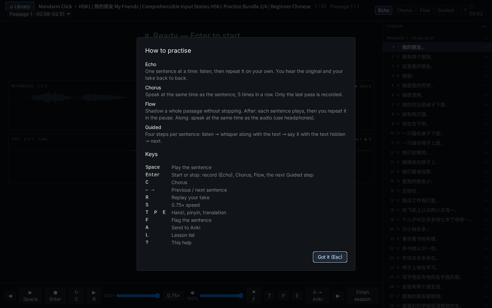

### Listening back

- Every take is kept. When you reopen a lesson, **R** plays your latest take of the current sentence and
  **Space** plays the original.
- In Flow mode the settings above the transcript offer your **last runs**. **Replay run** plays each sentence as original → you.
- The **reference volume** is adjustable. While you speak along, in Flow *along*, the reference drops to
  a quieter **guide level**, 50 % by default.

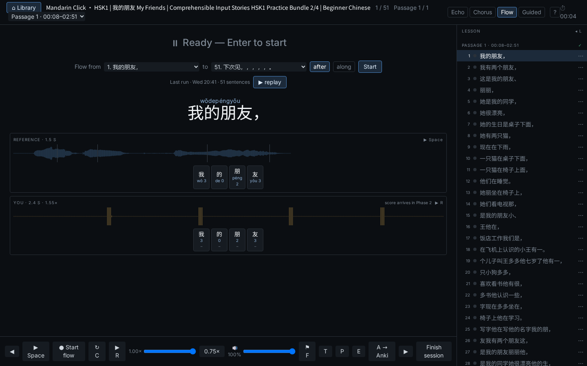

### Fix the text when the machine got it wrong

From the lesson drawer (click the "n / N" position) you can **edit** a sentence's text, **split** it in two, or **merge** it with the next one.
Each change re-aligns the audio, rebuilds the pinyin, and cuts new clips.

### Works with Yomitan

The sentence is ordinary text with one `<ruby>` per word, so the
[Yomitan](https://github.com/yomidevs/yomitan) pop-up dictionary works on it (hold Shift and hover). The karaoke wipe
is drawn as a separate layer and never changes the sentence's markup.

### Anki listening cards

Speaking happens in the app; Anki is used for **listening** review.

- **One-click setup:** Settings → **Set up chinese-shadow-speech deck** creates a deck and a *Shadow Listening* note type.
  The front is the audio only ("What did you hear?"). The back shows the hanzi, pinyin, translation (when the sentence has one) and a link back
  to the moment in the YouTube video.
- **End of session:** a dialog offers the sentences you practised. Fillers like 嗯, 对 and 好的 start unticked.
- **Nothing gets lost:** if Anki was closed, Review lists everything **practised but not yet in Anki**.

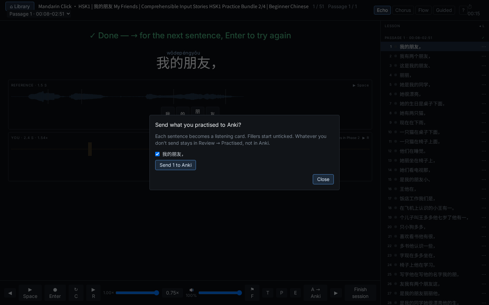

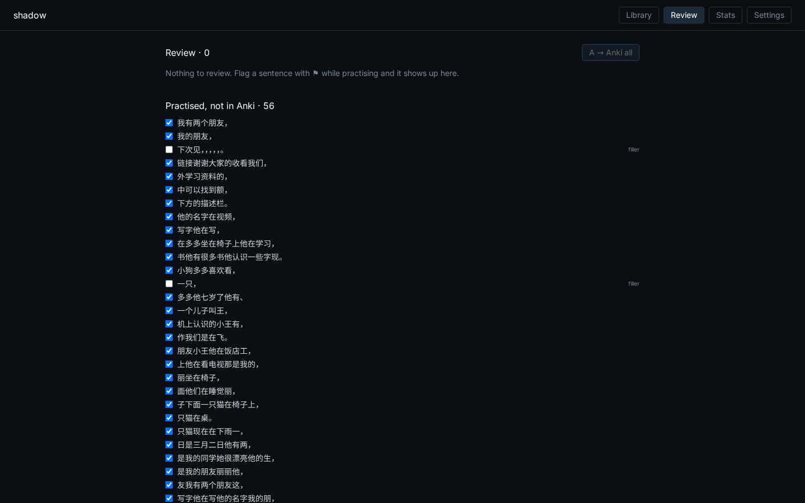

### Wrong sounds

After a scored take, a Chinese character-level CTC model checks the **initial and final** of each syllable (goodness of
pronunciation plus a bad-pronunciation score, fused). If you said a different sound, for example `cī` for 吃, the
**HEARD** row under your track shows the heard pinyin, and the
header chip reads "1 sound off" (or "sounds ok"). Click a cell on your track to hear that syllable of your take. Tones
and sounds are judged separately: a syllable can be a green sound with an orange tone.

Stats has a **Sounds** panel with your most-missed sounds and **Drill this**, which starts a drill with the `sound`
focus; its items go green when the sound is right. Run `make backfill-sounds` (`ARGS="--dry-run"`, `ARGS="--data-dir DIR"`)
to add sound results to older takes; stop the backend and back up the database first. Tune it under `[sounds]` in
`config.toml` (`enabled`, the model and its revision, the z-normalisers and the two thresholds).

Takes the recording itself rejects (too quiet or short, no voice, clipped, couldn't match or align, different words)
show their warning but are **not stored**. `backend/scripts/drop_failed_takes.py` (`--dry-run`, `--data-dir`) removes
older ones. Your take's playback skips the silence before and after your voice.

The backend trims its heap after model loads, jobs and scoring (`shadow/memory.py`). With all models loaded, the sound
model included, its RSS measured about 1.8 GB while scoring takes, instead of about 5.7 GB untrimmed; the startup peak
and the steady state are re-checked at acceptance (`docs/phase3a-acceptance.md`). `/health` lists `sounds` once its
warm-up has finished (about a minute after start); `sounds_error` says why sound checking is off.

### Stats

Minutes and attempts per day for the last 30 days, then the tone scores: your mean for each tone, a weekly line chart per
tone (last 12 weeks), an **After tone × tone** 5×5 matrix (so 3-3 sandhi shows up on its own), and your weakest
characters with trend arrows.

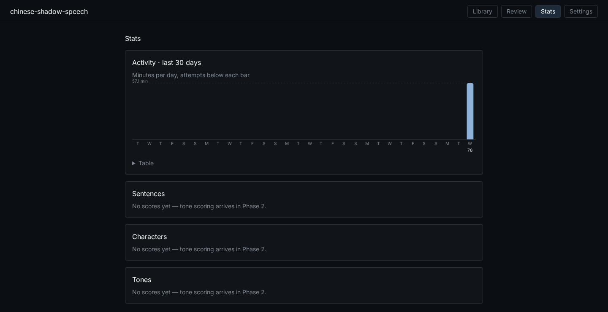

### Drills

The **Drill** tab (after Review) opens `/drill`. It shows today's focus with your mean: a tone, a tone pair like 3→3, or
a character. This is your weakest over the last 30 days; it needs at least 8 scored syllables, and a character must
appear in at least 2 sentences. Two alternatives are offered. Stats has **Drill this** on tone rows, tone-pair matrix
cells and character rows, and a Drills panel.

A drill is about 10 sentences from all your lessons, at most 4 per lesson while the others still have material. For each
sentence you listen once and speak along (karaoke wipe, guide volume), then make a scored Echo take with the target
syllables outlined. If all targets are green you move on; otherwise **Again**, up to 3 scored tries. Takes that are too
quiet or gated don't count. `→` skips a sentence and `R` replays your take.

The summary shows first → best on the target syllables, the green counts and the history for this focus. Sentences that
never went green get **Open in Practice** (it opens that sentence) and **Drill these again**.

Tune it in `config.toml` under `[drill]`: `window_days` 30, `min_rows` 8, `queue_size` 10, `max_tries` 3,
`max_per_lesson` 4, `min_syllables` 4, `max_syllables` 15, `rotate_within` 0.05.

### Settings

You can set:
- the AnkiConnect address, import queries and the export note type;
- practice preferences: hide the text while recording, the Flow gap factor, the "move on" hint and the default speed;
- the YouTube bookmarklet;
- your **Voice profile**, the pitch baseline tones are normalised to, with a **Reset voice profile** button.

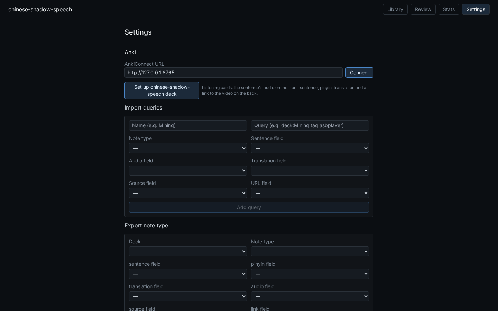

---

## How a lesson is made

```
YouTube link / file
   │  yt-dlp (audio only) · ffmpeg → 16 kHz mono WAV
   ▼
Speech recognition          FunASR Paraformer-zh, per-character timestamps
   │  + Chinese subtitles   text from the subtitles, timing from the recogniser
   ▼
Sentences                   split at punctuation: the subtitles' own, or what the small sherpa-onnx model adds (by default)
   ▼
Forced alignment            MMS_FA per sentence, repaired against the recogniser's character times
   ▼
Enrichment                  jieba words + pypinyin (tone sandhi), Opus/WAV clips, passages
```

All models run locally; the default device is the GPU (CUDA), with a CPU fallback. The only network calls are the
YouTube download and the one-time model downloads.

---

## Look

The app uses one dark, lacquer-style look on every page and dialog. Characters are set in a serif face, lesson tiles
and the sentence card have window-frame corners, and the waveforms are rounded and filled in the speaker's and your
colours. The control bar is `‹ n/N ›`, ▶ Listen, ● Record, Me, Anki and a Sound pop-up (speed, the 0.75× preset,
speaker volume and guide level, which also applies to the Drill's listen-along step). ⚑ Difficult and 字/pīn/EN sit on the sentence card. In the Drill the bar is the same,
with Anki hidden and Next in the accent colour while you review a sentence. There is no Finish session button: the session Anki offer appears
when you leave via ⌂ Library, and on the Flow summary's Done.

## Keyboard shortcuts

| Key | Action |
|---|---|
| `Space` | Listen (play the reference) |
| `Enter` | Record / stop (also starts and stops a Flow run) |
| `←` `→` | Previous / next sentence |
| `R` | Replay your take (Me) |
| `S` | 0.75× speed |
| `T` `P` `E` | Hide or show hanzi, pinyin, translation |
| `F` | Mark the sentence Difficult (⚑) |
| `A` | Send to Anki |
| `L` | Lesson list (opens or closes the drawer above the sentence navigator; Esc also closes it) |
| `?` | Help |

---

## Install on Windows

1. Download `chinese-shadow-speech-<version>-setup.exe` from the
   [latest release](https://github.com/BeatTheBullets/chinese-shadow-speech/releases/latest).
2. Run it. The installer is not code-signed yet, so Windows SmartScreen may say "Windows protected your PC": click
   **More info**, then **Run anyway**. It installs for your user only and does not ask for administrator rights.
3. The app opens a page in your browser that shows its first-run progress. The first start sets up Python and
   downloads the speech models, about 4 GB, so it takes 10 to 20 minutes depending on your connection. Later starts
   take a few seconds. The first start after installing a newer version takes a minute or two while the app updates
   itself (the models are kept, not downloaded again).
4. When it is ready, the Library opens. Paste a YouTube link to make your first lesson.

**Requirements:** Windows 10 or 11 (64-bit), 8 GB of RAM or more, 8 GB of free disk space for the first start (2 GB
for an update), and an internet connection for the first start and for YouTube lessons. No graphics card is needed.

**Using it:** start it from the Start menu (**Chinese Shadow Speech**). It runs in the background with an icon in the
notification area (bottom right). Use that icon to open the app again or to **Quit** it. Closing the browser tab
does not stop it.

**Your data** lives in `%LOCALAPPDATA%\chinese-shadow-speech`: lessons and recordings in `data`, speech models in
`models`, logs in `logs`. Installing a newer version keeps all of it. The app shows a notice in the Library when a
newer version is released.

**Uninstall** from Windows Settings → Apps → Installed apps → **Chinese Shadow Speech**. It asks whether to delete your
lessons, recordings and models too. The default is to keep them.

## Getting started

### Requirements

- WSL2 or Linux, with an NVIDIA GPU whose driver supports **CUDA 12.6** (Windows driver ≥ 560). A CPU works too, but slower: 8 GB of RAM is enough with `int8 = true` in `[models]` (see [docs/running.md](docs/running.md)).
- [uv](https://docs.astral.sh/uv/) (Python 3.12 is installed by uv), Node 20, ffmpeg.
- Optional:
  - [Deno](https://deno.com), which recent yt-dlp versions need for YouTube.
  - Anki with [AnkiConnect](https://ankiweb.net/shared/info/2055492159).

### Install and run

```bash
cd backend && uv sync --extra dev --extra models   # PyTorch (cu126), FunASR, aligners
cd ../frontend && npm install
cd .. && make dev                                  # backend on :8000, frontend on :5173
```

Open **http://localhost:5173**. The first lesson downloads the speech models (~1 GB Paraformer, ~1.2 GB MMS_FA). Run
`cd backend && uv run pytest -m models` once to check them. `curl -s localhost:8000/health` should report
`"device": "cuda"`.

Always pass both extras to `uv sync`. A plain `uv sync` uninstalls the model packages.

### Connect Anki

In Anki: Tools → Add-ons → AnkiConnect → Config, add the app to the allowed origins, and restart Anki:

```json
"webCorsOriginList": ["http://localhost", "http://localhost:5173", "http://127.0.0.1:8000"]
```

Then in the app: Settings → **Connect**, and **Set up chinese-shadow-speech deck**.

### Production build

```bash
cd frontend && npm run build && cd .. && make backend   # the backend serves the app on http://127.0.0.1:8000
```

[docs/running.md](docs/running.md) covers CPU-only use, Docker, YouTube cookies (for age-restricted videos and bot
checks), Deno and updating yt-dlp.

---

## Development

```bash
make test        # backend pytest, frontend vitest, eslint and the TypeScript type-check
```

Tests never need a GPU, network or model download. Every external model and service sits behind an interface with a
fake implementation.

| Path | What's there |
|---|---|
| `backend/shadow/ingest/` | download, ASR, subtitle alignment, sentence splitting, forced alignment and repair, enrichment, passages |
| `backend/shadow/api/` | FastAPI routes: lessons, segments, attempts, sessions, review, stats, drills (`/drill/focuses`, `/drill/sessions`), Anki import |
| `backend/shadow/drill/` | drills: focus ranking and rotation, the cross-lesson queue, summaries |
| `backend/shadow/store/` | SQLModel tables (SQLite) and the on-disk audio layout |
| `frontend/src/pages/` | Library, Practice (with Flow), Review, Drill, Stats, Settings |
| `frontend/src/lib/` | pure logic: cues, karaoke timing, flow scheduling, passages, keys, the drill step machine |
| `frontend/src/audio/` | clip player, AudioWorklet recorder (16 kHz PCM WAV), VAD |
| `docs/superpowers/specs/` | the design: [main spec](docs/superpowers/specs/2026-10-03-shadowing-tool-design.md), [YouTube/passages/guidance addendum](docs/superpowers/specs/2026-10-07-youtube-passages-guidance-design.md), [drills](docs/superpowers/specs/2026-10-14-phase3b-drills-design.md) |
| `docs/superpowers/plans/` | the implementation plans each phase was built from |
| `backend/shadow/scoring/` | pitch tracking, the tone model, syllable scoring, voice profile |
| `backend/shadow/scoring/sounds/` | wrong-sound detection: the character-CTC model, GOP and bad-pronunciation scores, fusion |
| `backend/shadow/memory.py` | heap trimming after model loads, jobs and scoring |
| `backend/scripts/` | `backfill_sounds.py` (`make backfill-sounds`), `drop_failed_takes.py`, `rescore.py`, `tone_model.py` |
| `docs/phase1-acceptance.md`, `docs/phase2-acceptance.md`, `docs/phase3a-acceptance.md`, `docs/phase3b-acceptance.md` | the manual checklists for things only a real browser, mic and Anki can verify |

---

## Roadmap

**Built:**
- **Phase 0–1:** the pipeline, the four practice modes, the Anki bridge and Yomitan rendering.
- **Phase 1.5:** YouTube lessons, passages, the guidance and karaoke cues, volume, listening cards, and recordings that come back when you reopen a lesson.
- **Phase 2:** tone scoring per syllable from a classifier trained on AISHELL-3 plus contour similarity, both normalised to each speaker's own baseline; pitch lines; stats per tone, tone pair and character. See [docs/phase2-acceptance.md](docs/phase2-acceptance.md).
- **Phase 3b:** drills on your weakest tone, tone pair or character, across all your lessons. See [docs/phase3b-acceptance.md](docs/phase3b-acceptance.md).
- **Phase 3a:** wrong-sound (initial/final) detection on every scored take, a Sounds panel and sound drills. See [docs/phase3a-acceptance.md](docs/phase3a-acceptance.md).

### Phase 4 — polish

Session statistics, and an optional Montreal Forced Aligner if timing still needs to be more precise.

### Known rough edges

- Two Flow runs that finish within a minute of each other are listed as one run.
- On YouTube auto-captions without punctuation, some sentence boundaries land mid-phrase. **Edit / Split / Merge**
  in the drawer fixes them.
- The Library page polls while a lesson is processing; very large libraries may want a smarter refresh.

---

## Licence

Chinese Shadow Speech is free software under the [GNU Affero General Public License v3.0 or later](LICENSE).
You may use, study, share and change it. If you distribute a changed version, or run one as a service other people
use over a network, you must make its source code available under the same licence.

The speech models it downloads have their own licences, listed in [THIRD_PARTY.md](THIRD_PARTY.md). The MMS
alignment model is non-commercial (CC-BY-NC 4.0), so the app as distributed is for non-commercial use.
