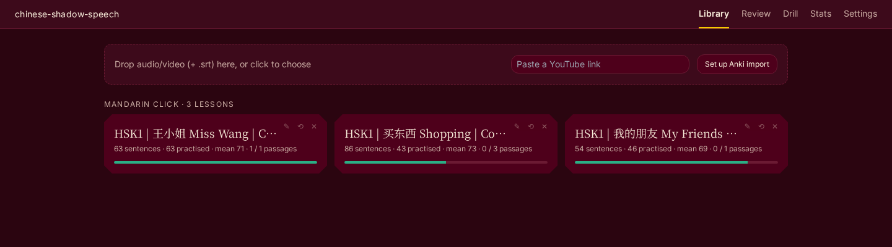
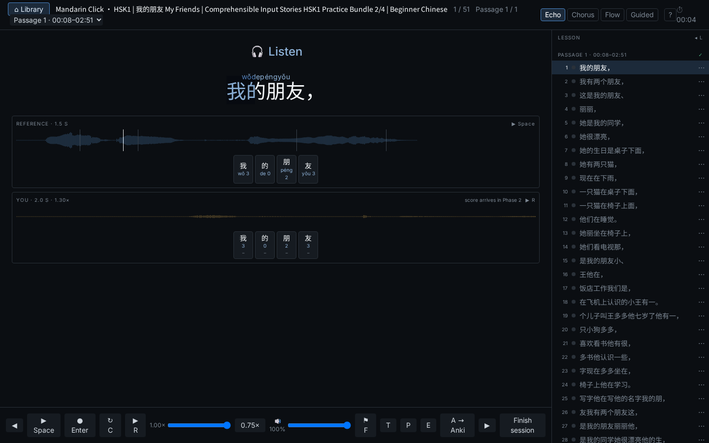
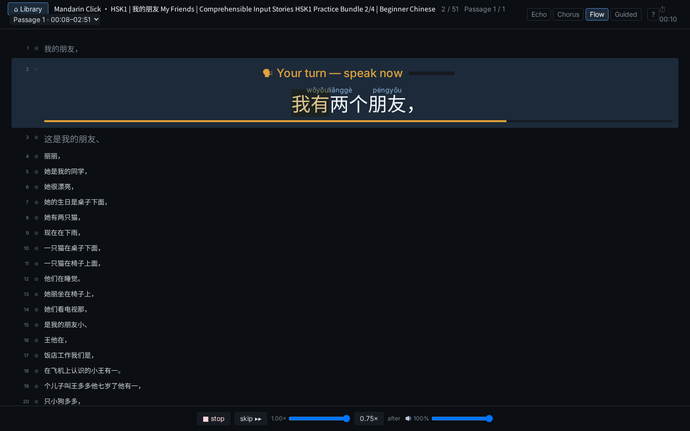
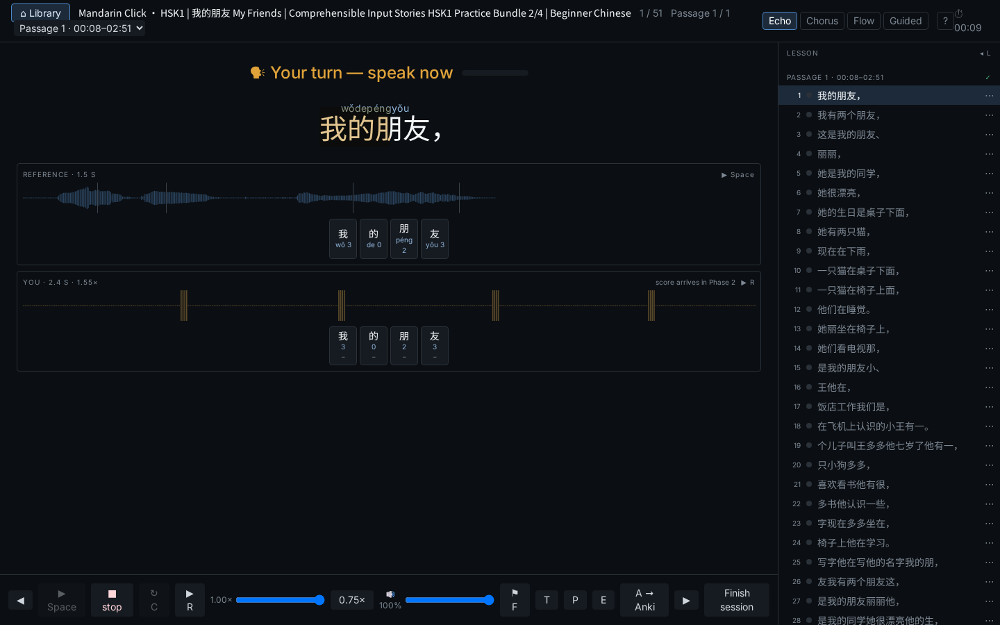
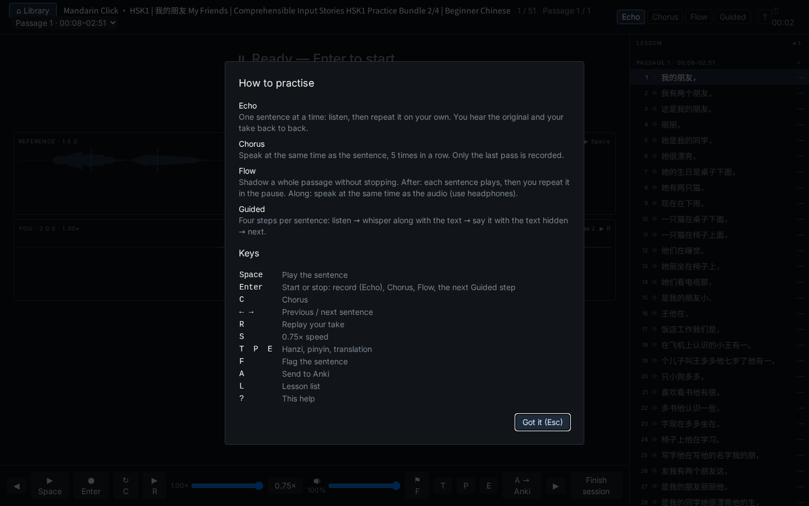
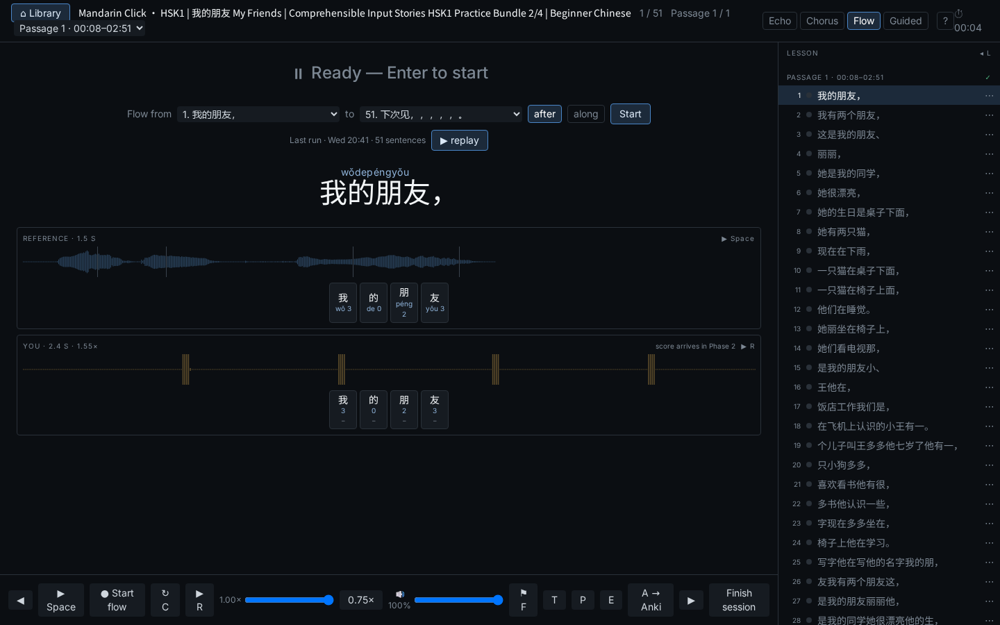
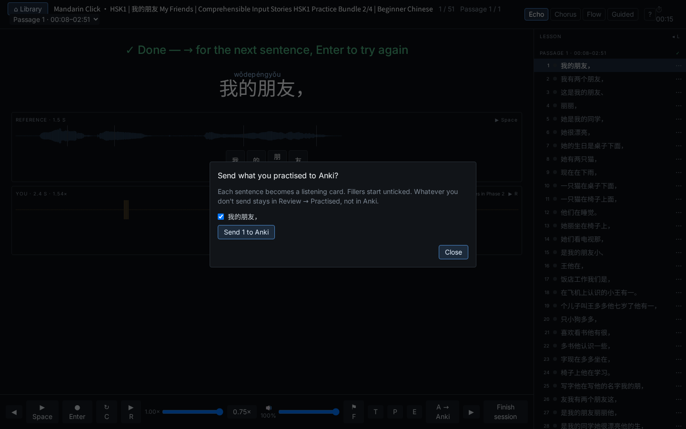
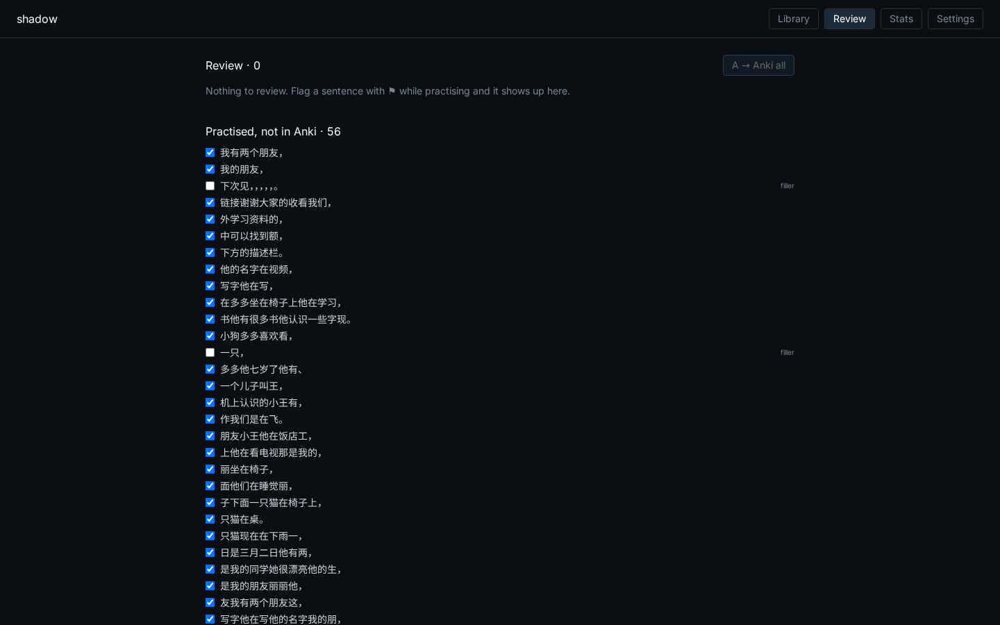
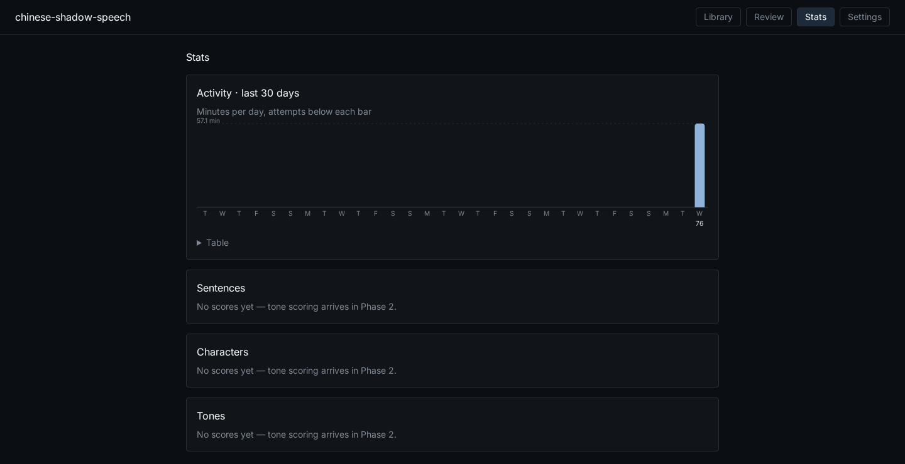
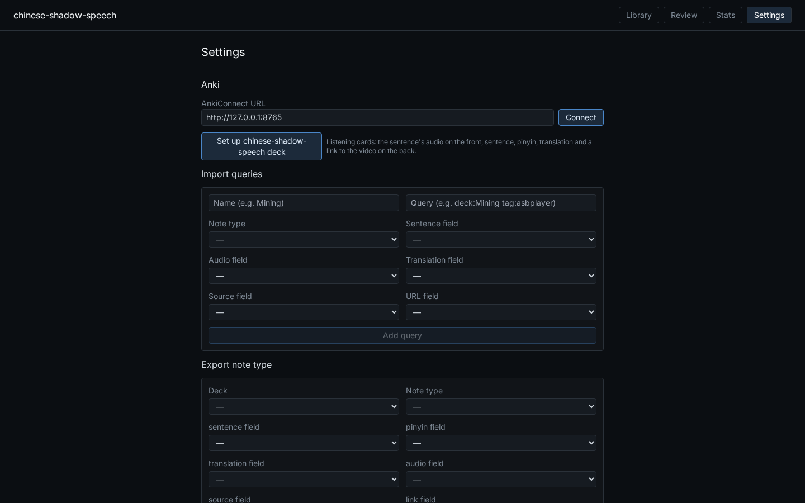

# User guide

Everything the app does, page by page. To install it, see the [README](../README.MD#install-on-windows).

- [Making a lesson](#making-a-lesson)
- [Practising: Echo and Flow](#practising-echo-and-flow)
- [Feedback on your take](#feedback-on-your-take)
- [Listening back](#listening-back)
- [Fixing the text](#fixing-the-text)
- [Anki listening cards](#anki-listening-cards)
- [Stats](#stats)
- [Drills](#drills)
- [Settings](#settings)
- [Keyboard shortcuts](#keyboard-shortcuts)
- [Your data on Windows](#your-data-on-windows)
- [Known rough edges](#known-rough-edges)

## Making a lesson

Paste a YouTube link into the **Library**, or use the **→ chinese-shadow-speech** bookmarklet (Settings → YouTube) on a
YouTube page. You can also drop an audio or video file, with or without a subtitle file (`.srt`) or a plain `.txt`
transcript. A few minutes later the lesson is ready:

- The whole video becomes one lesson, split into sentences and clauses at its punctuation.
- Long videos are split into **passages** of about 2–3 minutes. YouTube chapters are used when the video has them.
- Lessons are grouped by speaker (the YouTube channel). Each tile shows how many sentences and passages you have
  practised and your mean score.

When a YouTube video has real Chinese subtitles, their text is used, with the timing taken from the speech recogniser.
Machine-translated auto-captions are refused, and so are subtitles that don't match the audio.



## Practising: Echo and Flow

| Mode | What you do |
|---|---|
| **Echo** | One sentence at a time: listen, then repeat it on your own. You hear the original and your take back to back. |
| **Flow** | Shadow a whole passage without stopping. *After*: each sentence plays, then you repeat it in the pause. *Along*: speak at the same time as the audio (use headphones). |

The stage always shows what to do now:

- **Listening** while the speaker plays (**Listen — the original, then you** while your take is played back). The
  sentence fills with colour in time with the speaker.
- **Get ready** with a 3·2·1 ring (Flow only).
- **Your turn** (or **Speak along**): a red frame, a pulsing red dot, the take's timer and a live waveform of your voice.
- When nothing is going on, the button for the next step pulses gently: **Record** before a take (or a Flow run), **›**
  once the sentence has a take. With reduced motion switched on in your system, nothing moves.

In Flow the stage is compact, with a few lines before and after it, and a bar that shrinks over your speaking window.

Hover over a mode tab for a one-line explanation, or press `?` for the full help. The help also opens by itself on your
first visit.

| Echo, listening | Flow, your turn |
|---|---|
|  |  |

The sentence is ordinary text with one `<ruby>` per word, so the [Yomitan](https://github.com/yomidevs/yomitan) pop-up
dictionary works on it (hold Shift and hover).

## Feedback on your take

Below the sentence, two tracks show the reference and your take as waveforms trimmed to the voice, on one time scale,
with pitch lines drawn over both. Click a character on the sentence card to hear that syllable of the reference.

After a take, one row of cells shows how each syllable went; click a cell to hear your syllable:

- **Tones:** **green** is ok, **orange** is close, **red** is wrong and shows the target and the tone heard (for example
  `3→2`), **grey ∅** is unvoiced, and a **dashed outline** is a syllable that was missing.
- **Sounds:** the initial and final of each syllable are checked too. If you said a different sound, for example `cī`
  for 吃, a **HEARD** row under your track shows the pinyin heard, and the header chip reads "1 sound off" (or
  "sounds ok"). A syllable can be a green sound with an orange tone.
- **Words:** a speech recogniser checks that you said the sentence shown. A take of a different sentence is not scored
  ("Heard different words — not scored. Heard: …"); if only some words sounded different, the take is scored and the
  hint says so.

Takes that are silent, too quiet, clipped or too garbled to match the sentence show a warning and are not kept.

| Echo, your turn | Help |
|---|---|
|  |  |

## Listening back

- Every scored take is kept. When you reopen a lesson, **R** plays your latest take of the current sentence and
  **Space** plays the original.
- In Flow, the settings above the transcript offer your **last runs**. **Replay run** plays each sentence as original →
  you.
- The **Sound** pop-up sets the speed (0.75× preset), the speaker volume, and the **guide level**: how loud the speaker
  is while you speak along in Flow *along* (50 % by default).



## Fixing the text

From the lesson drawer (click the "n / N" position, or press `L`) you can **edit** a sentence's text, **split** it in
two, or **merge** it with the next one. Each change re-aligns the audio, rebuilds the pinyin, and cuts new clips.
Mark a sentence **⚑ Difficult** (`F`) to find it again in Review.

## Anki listening cards

Speaking happens in the app; Anki is used for **listening** review.

- **Setup:** install the [AnkiConnect](https://ankiweb.net/shared/info/2055492159) add-on. In Anki: Tools → Add-ons →
  AnkiConnect → Config, add the app to the allowed origins, and restart Anki:

  ```json
  "webCorsOriginList": ["http://localhost", "http://127.0.0.1:47231", "http://localhost:5173", "http://127.0.0.1:8000"]
  ```

  (`127.0.0.1:47231` is the Windows app; the other two are the development setup.) Then in the app: Settings →
  **Connect**, and **Set up chinese-shadow-speech deck**. This creates a deck and a *Shadow Listening* note type: the
  front is the audio only ("What did you hear?"); the back shows the hanzi, pinyin, translation (when there is one) and
  a link back to the moment in the YouTube video.
- **End of session:** when you leave a lesson, a dialog offers the sentences you practised. Fillers like 嗯, 对 and 好的
  start unticked.
- **Nothing gets lost:** if Anki was closed, **Review** lists everything practised but not yet in Anki, and your
  flagged sentences.

| End of session | Review |
|---|---|
|  |  |

## Stats

The **Stats** page has three scores for the last 30 days, each with its change since last week:

- **Characters:** the share of your takes where both the tone and the sound were right, over the characters you
  practised at least 3 times.
- **Tones:** your average tone score (neutral tones left out).
- **Sounds:** the share of syllables said right among the hard sounds (zh/ch/sh vs z/c/s, r vs l, ü vs u, -n vs -ng, and
  the vowel pairs ou/uo, an/en, ang/eng).

Below them are your weakest characters, tones and sounds, your Flow scores, activity, sentences to revisit and recent
drills. Each panel opens a detail page: the tone page has a weekly chart per tone and an **after tone × tone** matrix,
so 3-3 sandhi shows up on its own. Tone, tone-pair, sound and character rows have **Drill this**.



## Drills

The **Drill** tab shows today's focus with your mean: a tone, a tone pair like 3→3, a sound, or a character, picked as
your weakest over the last 30 days. Two alternatives are offered.

A drill is about 10 sentences from all your lessons. For each sentence you listen once and speak along, then make a
scored Echo take with the target syllables outlined. If all targets are green you move on; otherwise **Again**, up to 3
tries. `→` skips a sentence and `R` replays your take. The summary shows first → best on the targets; sentences that
never went green get **Open in Practice** and **Drill these again**.

## Settings



- **Anki:** the AnkiConnect address, the deck setup, import queries (make lessons from Anki notes) and the export note
  type.
- **Practice:** hide the text while recording, the Flow gap, the "move on" hint and the default speed.
- **Voice profile:** the pitch baseline your tones are compared against, with **Reset voice profile**.
- **YouTube:** the bookmarklet, and a **cookies file** for videos YouTube only shows to signed-in users (age checks, "sign
  in to confirm you're not a bot"). Export it from your browser with a cookies.txt extension.

## Keyboard shortcuts

| Key | Action |
|---|---|
| `Space` | Listen (play the reference) |
| `Enter` | Record / stop (also starts and stops a Flow run) |
| `←` `→` | Previous / next sentence |
| `R` | Replay your take (Me) |
| `S` | 0.75× speed |
| `T` `P` `E` | Hide or show hanzi, pinyin, translation |
| `F` | Mark the sentence Difficult (⚑) |
| `A` | Send to Anki |
| `L` | Lesson list (Esc closes it) |
| `?` | Help |

## Your data on Windows

Everything lives in `%LOCALAPPDATA%\chinese-shadow-speech`: lessons and recordings in `data`, speech models in `models`,
logs in `logs`.

- **Updates** keep all of it. The Library shows a notice when a newer version is released; download and run the new
  installer. The first start after an update takes a minute or two.
- **Deleting `models`** to free space is safe: the next start downloads them again (about 5 GB). Before each start the
  app checks that its prepared models are all there.
- **The app keeps running** in the notification area (bottom right) after you close the browser tab. Use its icon to
  open the app again or to **Quit**.
- **Uninstall** from Windows Settings → Apps → Installed apps → **Chinese Shadow Speech**. It asks whether to delete your
  lessons, recordings and models too; the default is to keep them.

## Known rough edges

- Two Flow runs that finish within a minute of each other are listed as one run.
- On YouTube auto-captions without punctuation, some sentence boundaries land mid-phrase. **Edit / Split / Merge** in
  the drawer fixes them.
- Very short sentences (one or two characters) are sometimes rejected as "different words".
- Building a lesson takes a while without a graphics card: a 5-minute video took about 2 minutes on a desktop CPU, and
  a laptop is slower. Start with short videos.
- If port 47231 is taken, the Windows app picks another one; add that address to AnkiConnect's
  `webCorsOriginList` too.
